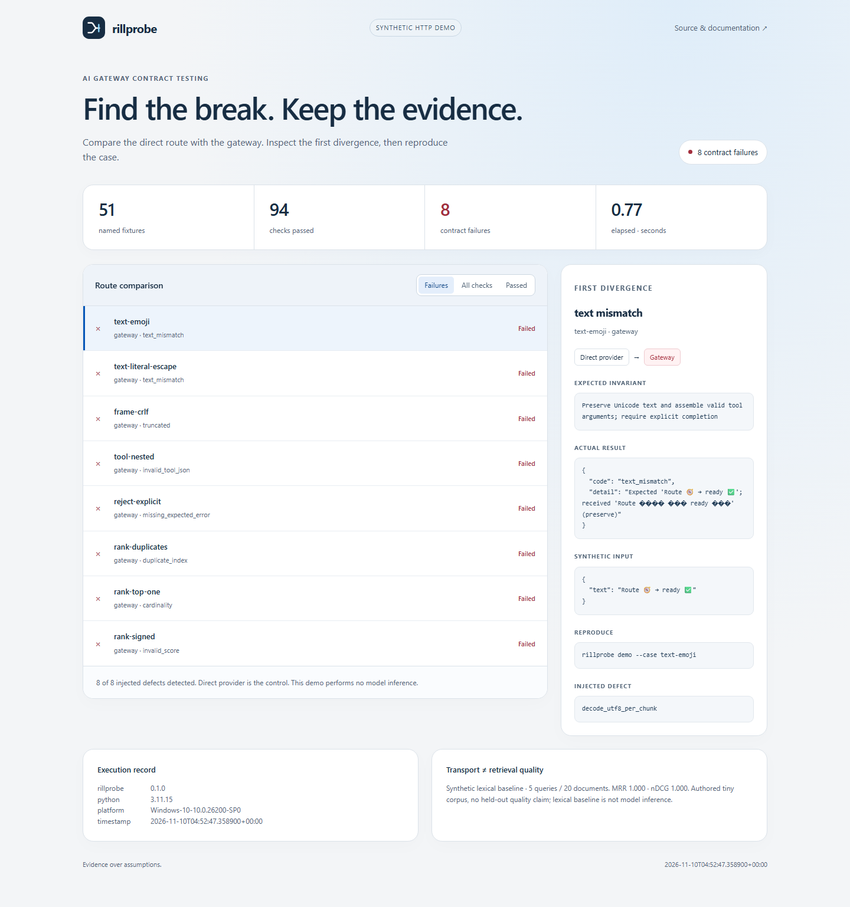

<p></p>

# Rillprobe

AI gateway contract testing for Unicode, SSE streams and rerank source indices. Compare a direct provider route with a gateway, find the first broken invariant, and keep a reproducible report.

Rillprobe is a small Python CLI with no runtime dependencies. It checks wire behavior separately from retrieval quality. It does not score the wording of model answers.



## Try it

Requires Python 3.11 or newer. From a clean checkout:

```sh
python -m venv .venv
# Linux/macOS:
. .venv/bin/activate
# Windows PowerShell instead: .\.venv\Scripts\Activate.ps1
python -m pip install .
rillprobe demo --output reports/broken
```

The demo intentionally exits **1**: the synthetic gateway contains eight defects. Open `reports/broken/report.html` in a browser. The JSON beside it contains each input, route, expected invariant, observed result and reproduction command. No account, key or model download is needed.

```sh
rillprobe demo --case rank-duplicates --output reports/duplicate
rillprobe demo --fixed --output reports/fixed
```

The repaired gateway exits **0**. Exit **2** means a configuration or output error. Both routes use a temporary loopback HTTP server; the gateway actually forwards to the direct route. The server is closed when the command finishes. [View the saved sample](https://bglglzd.github.io/rillprobe/) or [open the viewer locally](docs/index.html). The static viewer displays saved evidence and imports local JSON; it does not run Python or contact a model.

## What it checks

- **Text:** JSON escaping, Cyrillic, emoji, combining marks, explicit preserve/NFC policy, and UTF-8 split across byte boundaries.
- **SSE chat:** CR/LF/CRLF framing, multiline data, comments, BOM, usage-only chunks, fragmented tool arguments, explicit errors, cancellation and truncation. A successful stream needs a successful finish reason and `[DONE]`.
- **Rerank:** original positions, duplicate documents, `top_n`, empty input, finite descending scores and returned-document correspondence. Different models need not share a score scale.
- **Quality:** MRR and nDCG use authored relevance labels and original indices. The bundled five-query, twenty-document lexical baseline is synthetic; it is not a model benchmark or evidence of customer results.

There are 51 named synthetic fixtures. Eight fault seeds cover per-chunk Unicode decoding, double unescaping, missing termination, broken tool JSON, swallowed errors, duplicate index reconstruction, ignored `top_n` and nonfinite scores. [Contracts and architecture](docs/architecture.md) explain the exact profile.

## Probe a real endpoint

The chat adapter posts a normal streaming request to an OpenAI-compatible `chat/completions` route. For example, with your own local llama.cpp server:

```sh
rillprobe probe --base-url http://127.0.0.1:8080/v1 \
  --model your-loaded-model --repeat 3 --output reports/live
```

On PowerShell, put the command on one line instead of using shell backslashes. For an authenticated endpoint, add `--key-env RILLPROBE_API_KEY`, where that environment variable already contains your key. Never put credentials in the URL or command argument. Credentials require HTTPS except on loopback. Redirects are refused. Reports omit request authentication headers and redact the supplied key if an endpoint reflects it. Treat reports as data from your endpoint before sharing them.

For an endpoint supporting the Cohere-style/LiteLLM `rerank` response shape, use `--kind rerank`; this runs the small labelled corpus and reports transport and quality separately. The adapter is implemented, but **no real reranking service has been verified for v0.1**. A chat pass does not certify reranking, live tool calling, a particular gateway version or every API provider. [Verified scope](docs/verification.md) records the actual exercised runtime. Use `--server-version` to record an independently obtained runtime version; it is labelled as supplied metadata, not discovered by the tool.

Live requests use a fixed short prompt, temperature 0 and 64 maximum output tokens. Exact generated wording is never a contract expectation. Repeats exercise transport; they do not establish statistical model quality. The selected endpoint may charge for requests; Rillprobe does not calculate provider cost.

## A three-minute walkthrough

1. Run the broken demo. Select `rank-duplicates`: both source positions contain the same text, but the gateway incorrectly reconstructs the first index twice. The direct control passes; the gateway fails `duplicate_index`.
2. Inspect `text-emoji`. Decoding individual UTF-8 bytes with replacement produces valid JSON carrying corrupted text. The expected synthetic string catches the migration regression.
3. Run `--fixed`. All checked contracts pass. Compare reports; a repair changes actual resulting evidence, rather than a success label.
4. Optionally probe a real endpoint. The report switches to **Live execution**, records reported model IDs and server metadata, and makes no exact-text comparison.

## Development

```sh
python -m pip install -r requirements-dev.txt
python -m unittest discover -s tests -v
python -m ruff check .
python -m build
```

The tests exercise every byte partition of representative streams, seeded failure/recovery, malformed input, retrieval calculations, escaped HTML and credential reflection. CI runs domain/integration checks, static checks and packaging on Linux and Windows. See [contributing](CONTRIBUTING.md), [security](SECURITY.md) and [changelog](CHANGELOG.md).

Rillprobe is not a gateway, automatic migration tool, provider certification or model leaderboard. It applies a narrow contract profile and cannot prove production reliability. [MIT license](LICENSE).
