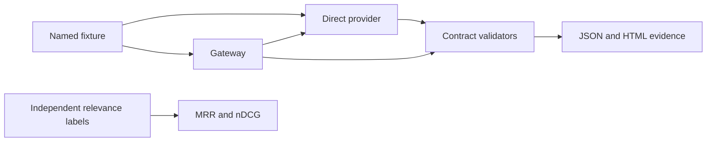

# Contract profile and architecture

Rillprobe serves developers comparing direct-provider and gateway behavior. It localizes deterministic transport failures; it does not decide which model gives a better answer.

The demo is synthetic. Its loopback HTTP gateway forwards each request to the direct route, then optionally applies a declared fault. A fixture header selects deterministic wire behavior in this sandbox only. Live requests never send that header. Correct fixtures and independent expected invariants are declared before execution in `fixtures.py`.

`sse.py` incrementally decodes strict UTF-8, frames SSE events and assembles one chat choice. It accepts role-only null content and usage-only events, requires choice index 0, explicit successful completion and `[DONE]`, and refuses partial tool JSON. The profile supports one choice and up to 128 tool slots, with distinct nonempty IDs and function names. It rejects length/content-filter termination as incomplete. The general SSE framing follows the [HTML Standard](https://html.spec.whatwg.org/multipage/server-sent-events.html); strict UTF-8 and chat completion semantics are additional product constraints. A stream is limited to 8 MiB. Cancellation is exercised by the fixture client; the CLI does not provide a separate interactive cancel button.

`contracts.py` keeps source positions separate from text identity. Duplicate strings remain separate documents. Scores must be finite and sorted descending, but may be negative, unbounded or tied. This profile expects exactly `min(top_n, document_count)` results. Some providers reject empty inputs or do not support `top_n=0`; such behavior is outside this profile rather than universally wrong. Rerank response shape follows the documented [LiteLLM rerank API](https://docs.litellm.ai/docs/rerank). Returning an index alone cannot prove a real model's semantic correspondence; synthetic fixtures additionally compare declared source order.

`runner.py` owns HTTP requests, route-local observations, bounded repeats, metadata and redaction. It refuses URL credentials and redirects. `report.py` embeds escaped JSON; the viewer uses text nodes and never interpolates imported strings as HTML. The report is self-contained and has no remote scripts, fonts or analytics. Live endpoint content may itself be private; only the supplied authentication value is automatically redacted.

`retrieval_metrics` evaluates ranked original indices with integer relevance grades 0–3. MRR uses grade greater than zero as relevant. nDCG uses gain `2^grade - 1` and log2 discount at the returned depth. A zero-relevance set yields zero nDCG. The bundled lexical baseline is an authored example, not a held-out benchmark. No LLM judge is involved.

There is no database, frontend framework, model SDK or portfolio-wide shared layer. Python's standard library is sufficient for this scope. The optional real chat adapter was exercised separately from the sandbox. No runtime model or model weight is distributed in the package.

## Positioning

Researched 2026-11-10. Rillprobe is a pronounceable own name for **AI gateway contract testing**. SwapProof was rejected because a commercial product already uses the name. Exact inspected GitHub/PyPI/npm searches found no Rillprobe package or repository; that does not establish legal clearance or worldwide uniqueness.

[LiteLLM](https://docs.litellm.ai/docs/rerank) provides gateway normalization and API adapters. Rillprobe tests a small set of incident-derived invariants at both sides of a gateway. [Langfuse experiment comparison](https://langfuse.com/docs/evaluation/experiments/compare-experiments) compares experiments and evaluation scores. Rillprobe provides byte-level streaming/index diagnostics and reproducible failures rather than an experiment platform. The portfolio's workflow replay product examines business service state; it is a different scope from wire contracts.
